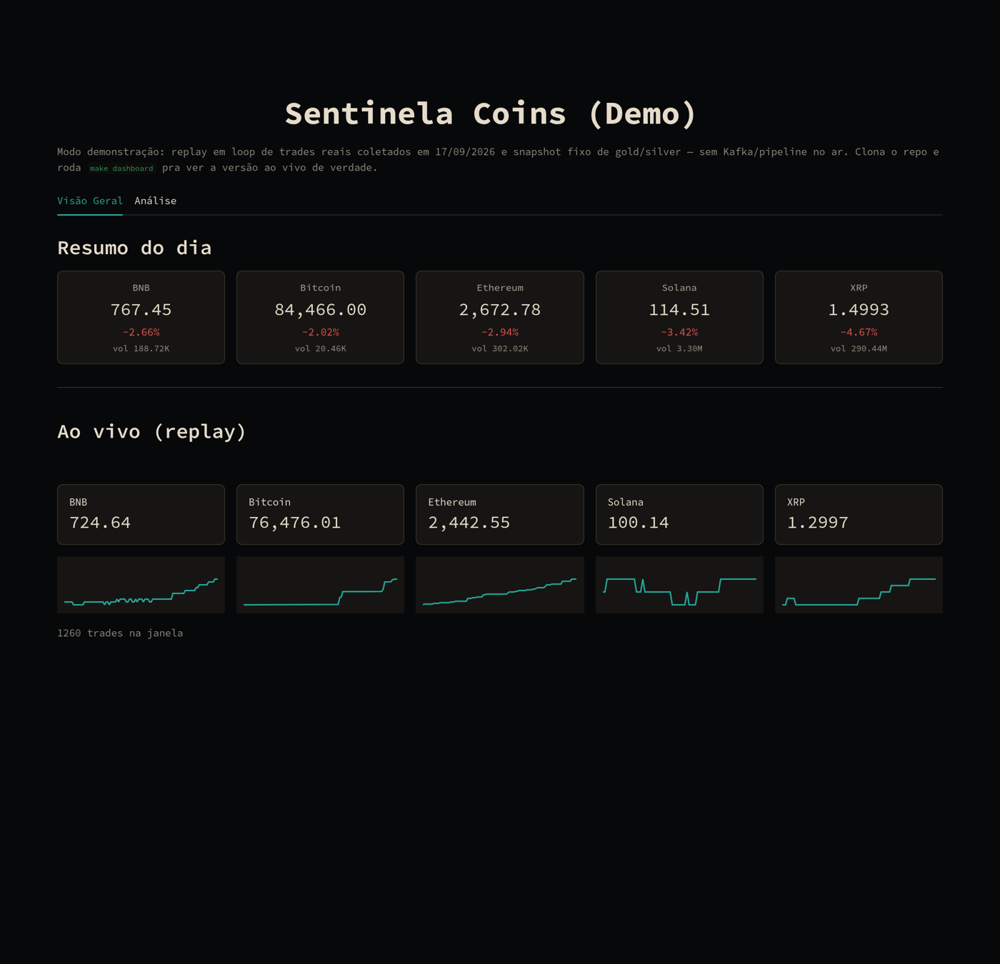
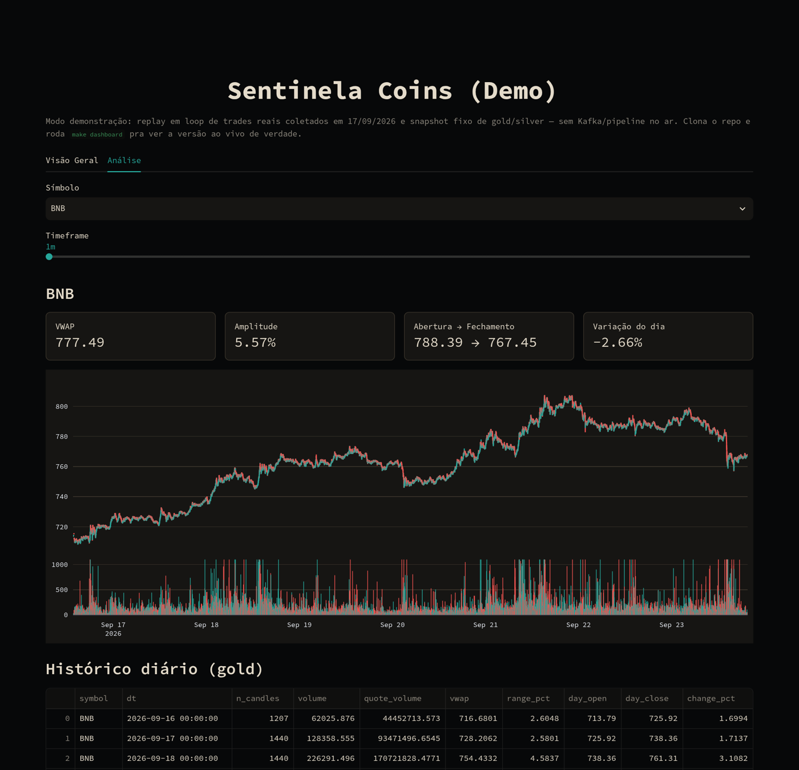
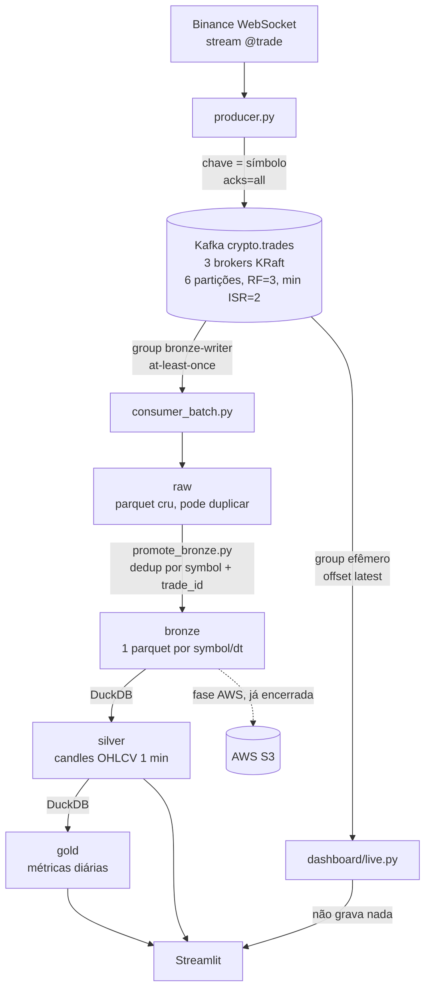
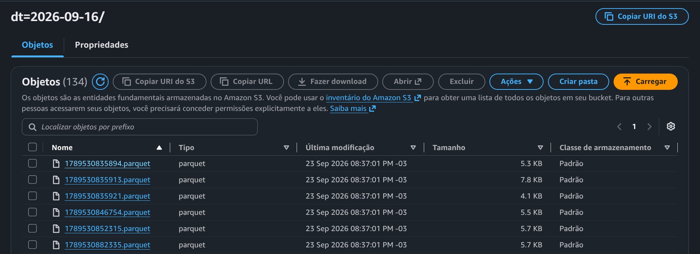
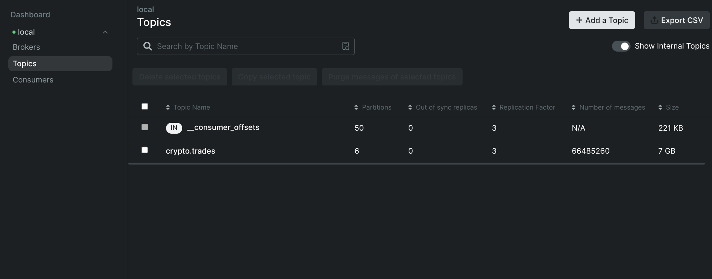

# Sentinela Coins: Crypto Streaming Lakehouse

Eu queria um pipeline de streaming que lidasse com dado de verdade, chegando rápido e sem parar, e que mesmo assim desse pra consultar o histórico depois. Peguei os trades de cripto da Binance, passei por um cluster Apache Kafka montado na mão e guardei tudo num lakehouse em camadas (medallion), com um dashboard em cima.

> TL;DR (EN). Streaming data pipeline over real Binance crypto trades. A 3-broker Apache Kafka cluster (KRaft, RF=3, min ISR=2, `acks=all`) feeds two consumer groups: an at-least-once batch consumer that lands Parquet into a raw zone, deduplicated by `(symbol, trade_id)` on promotion to bronze, and a live consumer for the dashboard (Lambda architecture). Silver (1-minute OHLCV candles) and gold (daily VWAP, volume, range) are built with DuckDB and Polars. Ran for 7 days locally: 66.1M trades, 169 duplicates found and explained. Bronze was also backfilled to AWS S3 with a least-privilege IAM user, then torn down.

[](https://github.com/romualdobarbosa/sentinela_coins/actions/workflows/ci.yml)
[](LICENSE)


## Demo

[sentinelacoins.streamlit.app](https://sentinelacoins.streamlit.app/). O link público não tem Kafka no ar. O bloco "Ao vivo" faz replay em loop de trades reais coletados durante a ingestão, e a aba Análise usa um snapshot do silver e do gold. Pra ver o streaming de verdade, clona o repo e roda local. (O app dorme quando ninguém acessa, então pode levar uns segundos pra acordar.)

| Visão Geral (resumo do dia + ao vivo) | Análise (candles + gold) |
|---|---|
|  |  |

## Em números

Rodada real de 16/09 a 23/09/2026, 5 pares (BTC, ETH, SOL, BNB, XRP).

| Métrica | Valor | De onde vem |
|---|---|---|
| Trades ingeridos | 66.123.102 | `make audit-bronze`, saída em [`docs/audit/bronze-2026-09.txt`](docs/audit/bronze-2026-09.txt) |
| Janela | 16/09 03:53 a 23/09 19:35 (cerca de 7 dias e 16 h) | idem |
| Média | 100 trades/s, contando as paradas | idem |
| Trades duplicados no bronze histórico | 169 (0,000256%) | idem |
| Bronze | 6.946 parquets, 539,9 MB | idem |
| Tópico `crypto.trades` | 6 partições, replication factor 3 | `docker-compose.yml` (serviço `kafka-init`) |
| `min.insync.replicas` | 2 | `docker-compose.yml` |
| `acks` do producer | `all` | `src/producer.py` |
| Réplicas em sync ao final | 168 de 168, cerca de 7 GB no cluster | [`docs/img/kafka-brokers.png`](docs/img/kafka-brokers.png) |
| Lag do consumer `bronze-writer` ao final | 0 | [`docs/img/kafka-consumer.png`](docs/img/kafka-consumer.png) |
| Silver | 55.115 candles de 1 min (11.023 por par) | `dashboard/demo_data/silver/candles_1m.parquet` |
| Gold | 40 linhas (5 pares x 8 dias) | `dashboard/demo_data/gold/daily_metrics.parquet` |
| Silver lendo o bronze do S3 contra local | cerca de 9 min contra 2 s | medição manual em 23/09 (seção Fase AWS) |
| Testes | 13 | `make test` |

## Arquitetura



É uma arquitetura Lambda. Do mesmo tópico saem dois caminhos, cada um no seu consumer group (no Kafka, ler não apaga a mensagem).

- Raw é a landing zone local, com o mesmo layout do bronze (`symbol=/dt=`). Pode ter trade duplicado, porque o `consumer_batch` só commita o offset depois de gravar. Se ele cair entre uma coisa e outra, o Kafka reentrega e a mensagem é gravada de novo.
- Bronze é o raw promovido e deduplicado. O `promote_bronze.py` agrupa por `(symbol, trade_id)` (a Binance já manda um `trade_id` único por símbolo, então o dedup é exato) e escreve 1 parquet com nome fixo por partição. Rodar de novo sobrescreve com o mesmo resultado.
- Silver são candles OHLCV de 1 minuto, tipados e agregados com DuckDB.
- Gold são as métricas por símbolo e dia (VWAP, volume, variação %, amplitude).

O raw antes do bronze segue o padrão write-audit-publish. Escolhi at-least-once na ingestão (nunca perder trade, mesmo arriscando duplicar) e concentrei a garantia de unicidade num ponto só, em vez de tentar exactly-once em toda escrita.

## Decisões

As 8 decisões principais, com contexto e consequência, estão em [`docs/adr/`](docs/adr/README.md). Em resumo, trade cru em vez de kline, 3 brokers pra ter replicação de verdade, tópico chaveado por símbolo, dois consumer groups, medallion junto com o caminho ao vivo, DuckDB em vez de Athena, dashboard lendo só as camadas agregadas e raw antes do bronze. O plano original de construção está em [`docs/plan.md`](docs/plan.md).

## Bugs que valeram a pena

### DuckDB não diferencia maiúscula de minúscula

O JSON da Binance tem duas colunas, `t` (trade id) e `T` (trade time). Quando o silver pedia `T`, o DuckDB devolvia `t` sem reclamar, e os candles saíam com data de 1970, porque o trade id estava sendo lido como timestamp. Achei comparando a mesma leitura no Polars, que diferencia, e no DuckDB. A correção foi o silver ler as colunas `price`, `qty` e `trade_time` que o `consumer_batch` já grava tipadas, e o teste do silver passou a gerar o bronze pelo `flush()` de verdade em vez de um parquet escrito à mão.

### YAML folded scalar no `kafka-init`

O `command: >` do container que cria o tópico tinha uma linha mais indentada que as outras. Num folded scalar isso preserva a quebra de linha em vez de virar espaço, então o shell rodava dois comandos (o `--create` sem `--topic` e depois um `--topic ...` solto). Corrigi alinhando a indentação.

### As 169 duplicatas

A rodada de 7 dias foi antes da camada raw, com o consumer gravando direto no bronze. Auditando depois (`make audit-bronze`), achei 169 trades repetidos em 66.123.102, todos numa mesma janela na madrugada de 16/09, espalhados por 5 arquivos, com cara de reentrega depois de um restart do consumer. É pouco, mas mostra que o at-least-once duplica na prática, e é o caso que o raw com dedup resolve.

## Limitações

- O bronze histórico de 7 dias não foi reprocessado pelo fluxo novo. As 169 duplicatas continuam lá, e quem lê esse bronze precisa saber disso.
- A ingestão ficou parada cerca de 10 h entre o teste inicial e a rodada contínua. O silver preenche esses minutos com candles flat (forward-fill) e o dashboard os descarta do gráfico, mas nenhum check de qualidade avisa que o buraco existiu.
- A medição de 9 min contra 2 s no S3 foi com o bronze antigo (milhares de arquivos pequenos). Com o bronze promovido, de 1 arquivo por partição, não medi de novo.
- O CI não sobe Kafka. Os testes cobrem a lógica pura (producer, flush, promoção, silver, gold, gráfico).
- É um projeto de portfólio, roda numa máquina só e não tem pretensão de produção.

## Como rodar

Pré-requisitos: [Podman](https://podman.io/) com `podman-compose`, [uv](https://docs.astral.sh/uv/) e Python 3.11+.

Caminho rápido, só o dashboard em modo demo (sem Kafka):

```bash
uv sync
DASHBOARD_MODE=demo make dashboard
```

Caminho completo:

```bash
uv sync            # cria o .venv e instala tudo a partir do uv.lock
cp .env.example .env

make up            # 3 brokers + tópico + kafka-ui (http://localhost:8080)
```

Depois, em terminais separados:

```bash
make producer      # 1. ingestão: Binance -> Kafka
make batch         # 2. Kafka -> raw (deixa rodando uns minutos)
make pipeline      # 3. raw -> bronze (dedup) -> silver -> gold
make dashboard     # 4. Streamlit
```

Sem alguns minutos de producer e batch rodando, não tem dado suficiente pra formar candles. Pra deixar a ingestão rodando em background, use `make run-bg` (e `make stop-bg` pra parar).

Parar tudo com `make down`. Se o Kafka der problema no boot, `make reset` apaga o estado e sobe limpo.

## Fase AWS

Executada em 23/09/2026 e já encerrada, com custo perto de zero (o bronze de 540 MB ficou no S3 por poucas horas).

1. Bucket S3 com block public access ligado e um IAM user com permissão restrita a esse bucket (nada de conta root nem `AdministratorAccess`). Access key só no `.env`, que é gitignored, junto com `S3_BUCKET` e `AWS_REGION`.
2. `make backfill-s3` (`scripts/backfill_s3.py`) sobe o bronze local pro S3 preservando o layout `symbol=/dt=`. É idempotente e confere contagem e bytes no fim (6.946 arquivos, 539,9 MB).
3. `BRONZE_PATH=s3://<bucket>/bronze make promote` faz o `promote_bronze.py` gravar o parquet deduplicado direto no S3 via `s3fs`. O raw continua sempre local.
4. `BRONZE_PATH=s3://<bucket>/bronze make silver` faz o `silver.py` carregar o `httpfs`, pegar a credencial pelo Secrets Manager do DuckDB e ler o bronze direto do S3. O resultado bateu com o local (as mesmas 55.115 linhas, OHLC e `trades` iguais, só ruído de ponto flutuante na soma do volume). Levou cerca de 9 min contra 2 s local, por causa dos milhares de arquivos pequenos.


Backfill (arquivos de 16/09, todos enviados no mesmo instante pelo script):



Flushes do `consumer_batch` ao vivo no S3 em 23/09, do mais novo pro mais antigo. Os de 20:49 são o consumer zerando o backlog do Kafka, e depois ele cai pro ritmo normal (flush por tempo, 120 s no teste).


Silver e gold ficaram locais, porque o bronze já prova a integração. Depois das evidências, apaguei o bucket e a access key, então nada ficou no ar gerando custo. Pra repetir, crie um bucket e uma key nova e rode os passos acima. Pra voltar ao 100% local, comente as chaves e mantenha `BRONZE_PATH=./data/bronze`.

Kafka-ui ao final da ingestão:





## Desenvolvimento

```bash
make lint          # ruff check + ruff format --check
make test          # pytest (lógica pura, não precisa do Kafka)
make all           # os dois
pre-commit install # ruff a cada commit
```

O CI no GitHub Actions roda lint e testes em todo push no `main` e em todo PR.

## Stack

Python 3.11, Apache Kafka 3.7 (KRaft, imagem Confluent), confluent-kafka, websockets, Polars, DuckDB, Streamlit, Plotly, Podman (Docker Compose), uv, ruff, pytest, GitHub Actions, AWS S3, AWS IAM, s3fs.

## Licença

MIT. Veja [LICENSE](LICENSE).
