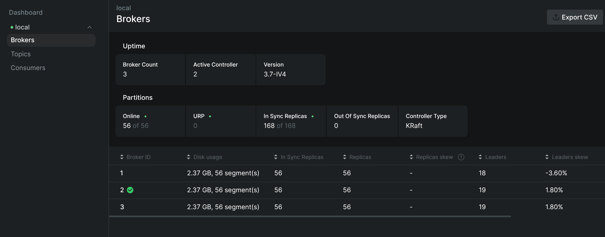
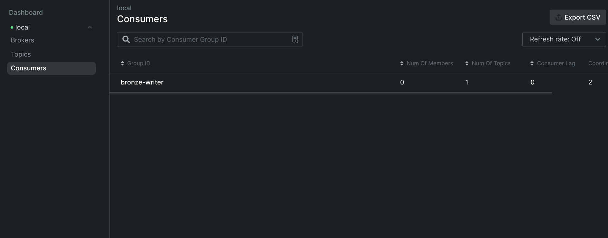
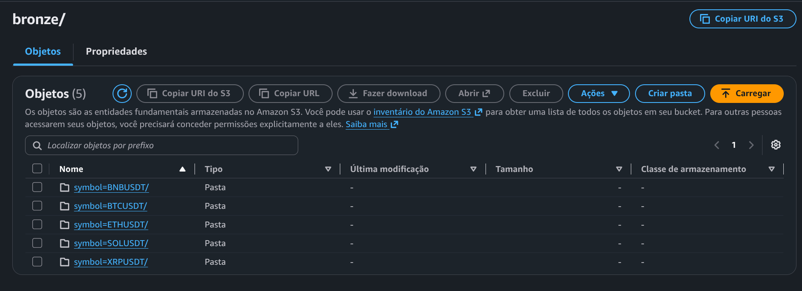
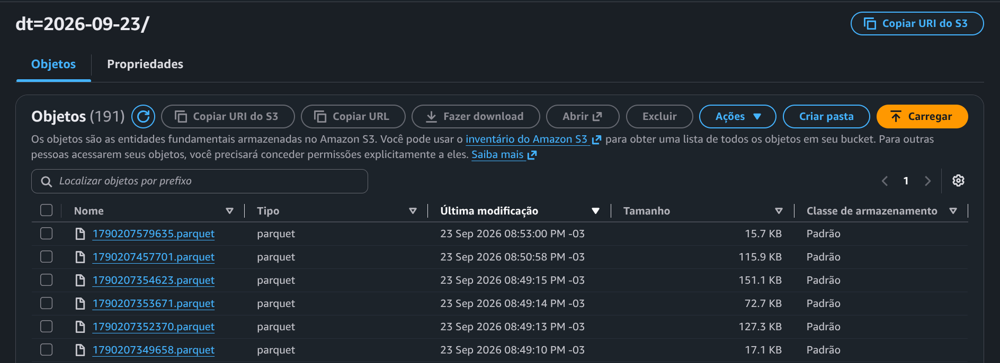

# Crypto Streaming Lakehouse

Pipeline de dados em streaming sobre trades de cripto (Binance), com Kafka (3 brokers,
replicação real) e arquitetura medallion. Dois consumers no mesmo tópico: um batch
(alimenta o lakehouse) e um live (speed layer do dashboard). Arquitetura Lambda.

**Demo:** [sentinelacoins.streamlit.app](https://sentinelacoins.streamlit.app/) — link
público, sem Kafka no ar: a aba "Ao vivo" faz replay em loop de um snapshot de trades
reais coletados durante a ingestão, só pra dar uma ideia visual do painel. Pra ver o
pipeline rodando de verdade (Kafka + streaming real), clona o repo e roda local.

## Arquitetura

```
Binance WS ──> producer.py ──> Kafka (crypto.trades, 6 part., RF=3)
                                   │
                    ┌──────────────┴───────────────┐
              consumer_batch.py               dashboard/live.py
                    │                               │
                raw (parquet cru, pode duplicar)   painel "ao vivo"
                    │
                promote_bronze.py (dedup por symbol+trade_id)
                    │
                bronze (parquet cru, sem duplicata)
                    │
                silver (candles 1m, DuckDB)
                    │
                gold (métricas diárias, DuckDB)
                    │
                Streamlit (aba Análise)
```

- **Raw**: landing zone local, mesmo layout do bronze (`symbol/dt`), mas pode ter trade
  duplicado — `consumer_batch` só commita o offset no Kafka *depois* de gravar; se cair
  no meio, o replay reescreve a mesma mensagem num arquivo novo.
- **Bronze**: raw promovido e deduplicado. `promote_bronze.py` agrupa por `(symbol, trade_id)`
  — a Binance já manda um `trade_id` único por símbolo em cada trade, então dedup é exato,
  sem heurística — e escreve 1 parquet por partição com nome fixo, o que também torna a
  promoção idempotente (rodar de novo sobrescreve com o mesmo resultado). Depois disso,
  imutável, zero transformação de negócio.
- **Silver**: candles OHLCV de 1min, tipado e agregado (DuckDB).
- **Gold**: métricas de negócio por símbolo/dia — VWAP, volume, variação %, amplitude.

Esse raw→bronze é o padrão **write-audit-publish**: escreve num lugar tolerante a falha,
audita (aqui, dedup), só então publica no lugar confiável. Existe porque `consumer_batch`
escolhe deliberadamente **at-least-once** (nunca perder trade, arriscando duplicar) em vez
de at-most-once — exactly-once na ingestão em si seria caro/complexo pra esse projeto, então
a garantia de unicidade foi isolada num único ponto em vez de exigida em toda escrita.

## Stack

Python · confluent-kafka · websockets · Polars · DuckDB · Streamlit · Podman

## Rodando local

Pré: [Podman](https://podman.io/) (com o plugin `podman compose`, via `podman-compose`),
[uv](https://docs.astral.sh/uv/) e Python 3.11+.

```bash
uv sync            # cria o .venv e instala tudo (produção + dev), a partir do uv.lock
cp .env.example .env

make up            # 3 brokers + tópico + kafka-ui (http://localhost:8080)
```

Depois, em terminais separados:

```bash
make producer      # 1. ingestão: Binance -> Kafka
make batch         # 2. Kafka -> raw (deixa rodando um tempo pra acumular dado)
make pipeline      # 3. raw -> bronze (dedup) -> silver -> gold
make dashboard     # 4. Streamlit (aba Análise + aba Ao vivo)
```

Deixa o producer + batch rodando uns minutos antes do `make pipeline`, senão não tem
dado suficiente pra formar candles.

Parar tudo: `make down`. Se o Kafka bugar no boot: `make reset` (apaga o estado e sobe limpo).

## Resultados (ingestão real, 16/09 a 23/09/2026)

Sete dias de ingestão contínua da Binance, 5 pares (BTC, ETH, SOL, BNB, XRP). Essa rodada é
anterior à camada raw + `promote_bronze.py` descrita acima (adicionada depois, como
salvaguarda contra duplicata em caso de crash entre flush e commit do offset) — os números
abaixo refletem o `consumer_batch` gravando direto no bronze, como era na época:

| | |
|---|---|
| Trades ingeridos | ~66 milhões (~99 trades/s combinados) |
| Tópico `crypto.trades` | 6 partições, RF=3, 3 brokers em sync (168/168 réplicas), ~7 GB no cluster |
| Bronze | ~7 mil parquets, ~540 MB, particionado `symbol=/dt=` |
| Silver | 55.115 candles de 1 min (11.023 por par) |
| Gold | 40 linhas (5 pares x 8 dias) |
| Consumer `bronze-writer` | lag 0 ao final |

Kafka-ui ao final da ingestão:





Nota sobre gaps: a ingestão ficou parada ~10h entre o teste inicial e a rodada contínua.
O silver preenche esses minutos com candles flat (forward-fill) e o dashboard os descarta
do gráfico, colapsando o trecho no eixo do tempo.

## Fase AWS (provar uso da cloud)

Executada em 23/09/2026, com custo ~zero (bronze de ~540 MB no S3 por poucas horas).

1. Bucket S3 (block public access ligado) + IAM user com permissão restrita a esse bucket
   (não usa a conta root nem `AdministratorAccess`); access key/secret só no `.env`
   (gitignored), com `S3_BUCKET` e `AWS_REGION`.
2. `make backfill-s3` (`scripts/backfill_s3.py`): sobe o bronze local pro S3 preservando o
   layout `symbol=/dt=`. Idempotente e confere contagem/bytes no fim (6.946 arquivos, 539,9 MB).
   Essa rodada foi feita antes da camada raw existir; hoje o bronze local que alimenta o
   backfill viria de `make promote` em vez do `consumer_batch` direto.
3. `BRONZE_PATH=s3://<bucket>/bronze make promote`: `promote_bronze.py` detecta o prefixo
   `s3://` e grava o parquet deduplicado direto no S3 via `s3fs` (o raw continua sempre
   local — não tem por que ele ir pro S3, é descartável).
4. `BRONZE_PATH=s3://<bucket>/bronze make silver`: `silver.py` carrega `httpfs` + credencial
   via DuckDB Secrets Manager e lê o bronze direto do S3. O resultado é idêntico ao do bronze
   local (mesmas 55.115 linhas; OHLC e `trades` iguais, só ruído de ponto flutuante na soma
   do volume). Custo: ~9 min lendo do S3 contra ~2 s local, esperado pra ~7 mil arquivos pequenos.



Backfill (arquivos de 16/09, todos enviados no mesmo instante pelo script):


Streaming ao vivo: flushes do `consumer_batch` em 23/09, ordenados do mais novo. Os de
20:49 são o consumer zerando o backlog do Kafka; depois cai pro ritmo normal (flush por
tempo, 120 s no teste):



Silver e gold continuam locais (só o bronze prova a integração com a cloud). É vitrine,
não produção: depois de tirar as evidências acima, o bucket foi apagado e a access key
do IAM user foi removida, então nada fica no ar nem gera custo. Pra repetir: crie um bucket
e uma key nova e rode os passos acima. Pra voltar ao 100% local: comenta as chaves e mantém
`BRONZE_PATH=./data/bronze` (o `RAW_PATH` nunca muda, é sempre local).

## Desenvolvimento

```bash
uv run ruff check .          # lint
uv run ruff format .         # format
uv run pytest                # testes (lógica pura, não precisa do Kafka no ar)
pre-commit install           # roda ruff automaticamente a cada commit
```

CI no GitHub Actions roda ruff + pytest em cada PR.

## Notas

- 3 brokers KRaft (sem Zookeeper). RF=3 exige os 3 no ar.
- Tópico com 6 partições, chaveado por símbolo (mesmo símbolo -> mesma partição, ordem preservada).
- Consumers com `group.id` distintos -> offsets independentes; ler não apaga.
- `consumer_batch` é at-least-once por design (commita o offset só depois de gravar, então
  nunca perde trade) — o preço é que pode duplicar no raw se cair no meio. `promote_bronze.py`
  aplica write-audit-publish: audita (dedup por `symbol`+`trade_id`) antes de publicar no
  bronze, e faz isso com escrita idempotente (nome de arquivo fixo por partição, não
  timestamp), então rodar de novo nunca duplica.
